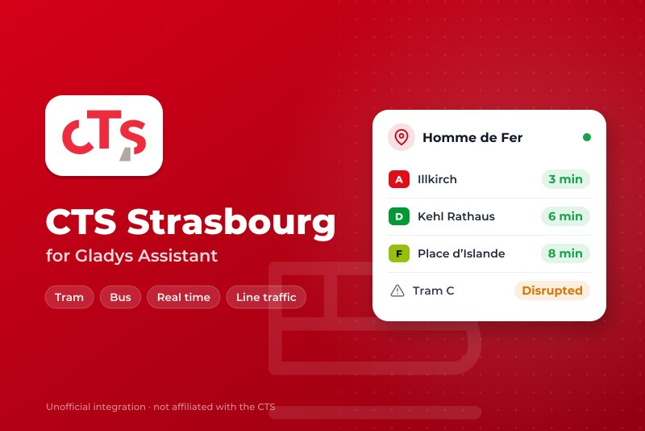
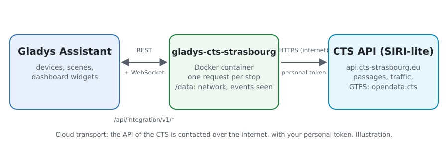
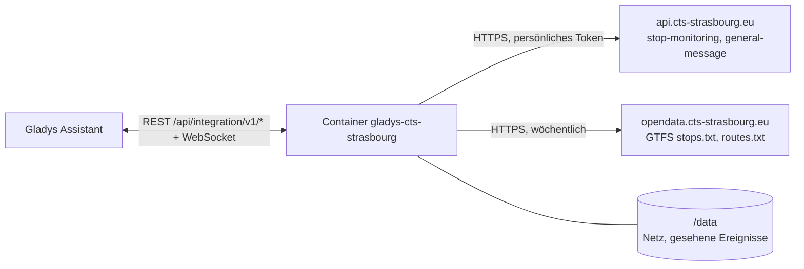
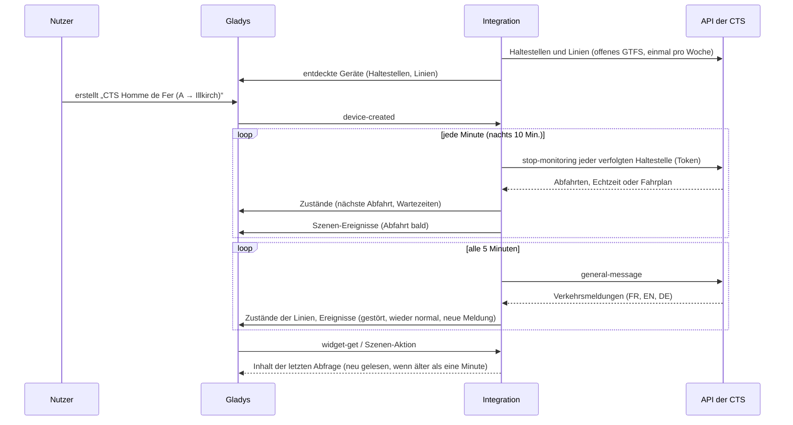
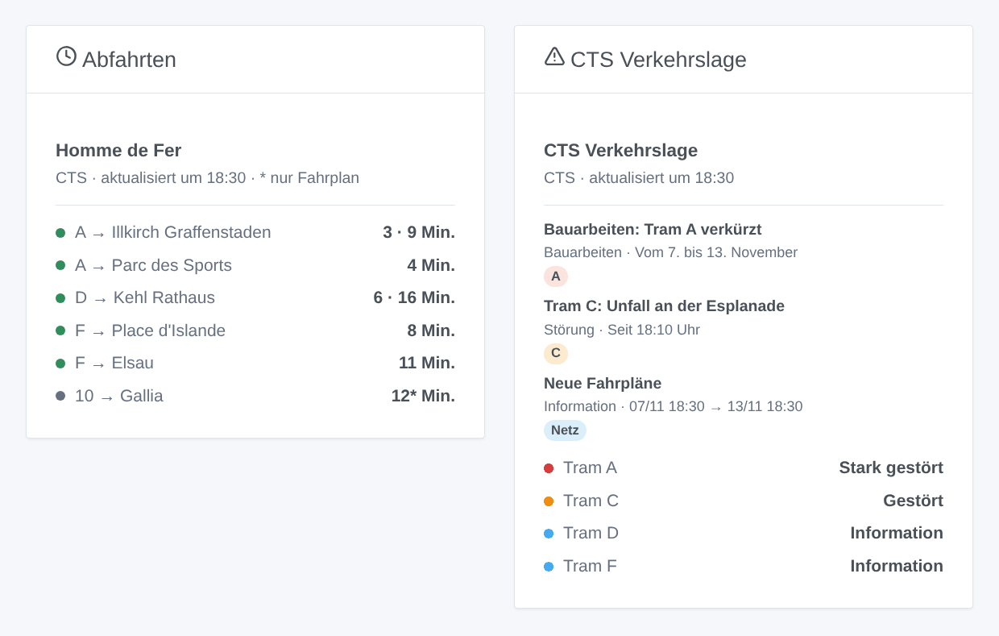

# Gladys CTS Strasbourg

[English](README.md) · [Français](README.fr.md) · **Deutsch** · [Español](README.es.md)

[](LICENSE)
[](https://github.com/William-De71/gladys-cts-strasbourg/releases)
[](https://github.com/William-De71/gladys-cts-strasbourg/actions/workflows/release.yml)
[](https://gladysassistant.com)



Externe [Gladys Assistant](https://gladysassistant.com)-Integration für die **CTS**, die Trams und Busse von Straßburg: die nächsten Abfahrten in Echtzeit an deinen Haltestellen und die Verkehrslage deiner Linien, mit Szenen und Dashboard-Widgets. Sie liest die offizielle Echtzeit-API der Compagnie des Transports Strasbourgeois (SIRI-lite), mit deinem persönlichen Token.

Benutzerdokumentation: [English](docs/en.md) · [Français](docs/fr.md) · [Deutsch](docs/de.md) · [Español](docs/es.md).

> Community-Integration, weder mit der Compagnie des Transports Strasbourgeois noch mit der Eurometropole Straßburg verbunden oder von ihnen unterstützt.

> **Noch nicht mit einem echten Token getestet.** Der Code folgt der veröffentlichten Beschreibung der API (`swagger.json`), und die Tests nutzen danach gebaute Antworten. Rückmeldungen von Nutzern mit Token sind willkommen.

## Funktionen

- **Ein Gerät pro verfolgter Haltestelle** (drei im Formular, bis zu 7 weitere mit der Schaltfläche **Haltestelle hinzufügen**), per Name oder Code eingegeben („275“ für die ganze Haltestelle, „275A“ für einen Steig) und nach **Linie** („A“, „C1“, „2“ oder „tram“, „bus“) und **Richtung** gefiltert: nächste Abfahrt, Wartezeit der nächsten zwei Abfahrten, Zahl der Verkehrsmeldungen zu ihren Linien.
- **Ein Gerät pro verfolgter Linie**: ihre Verkehrslage (normal, Information, gestört, stark gestört) und ihre Zahl der Verkehrsmeldungen.
- **Echtzeit**: die geschätzte Zeit, wenn das Fahrzeug live verfolgt wird, sonst der Fahrplan (als solcher markiert).
- **4 Szenen-Auslöser**, **2 Szenen-Aktionen** und **2 Dashboard-Widgets** (unten).
- **Rücksichtsvoll mit der API**: eine Anfrage pro Haltestelle, Antworten so lange behalten, wie ihr `cache-control` sagt, 5 Minuten Pause nach einem 429, weniger Abfragen nachts.
- **Haltestellensuche ohne Anfrage**: die Namen und Codes stammen aus dem offenen GTFS der CTS, wöchentlich gelesen und in `/data` gespeichert.
- Konfigurationsschaltflächen: Verbindung testen, Haltestelle suchen, Haltestellen hinzufügen / entfernen / auflisten, Diagnose (ohne Token).
- Überall vier Sprachen: Englisch, Französisch, Deutsch, Spanisch.

## Funktionsweise





Beim Start liest die Integration die Haltestellen und Linien des offenen GTFS der CTS (nur `stops.txt` und `routes.txt` des Zip): ein `stop_code` „275A“ ist ein Steig von Homme de Fer, sein logischer Code „275“ die ganze Haltestelle. Sie löst deine Eingaben auf, liest dann jede verfolgte Haltestelle (`siri/2.0/stop-monitoring?MonitoringRef=275`) mit ihrem eigenen Timer und die Verkehrslage des Netzes (`siri/2.0/general-message`) alle 5 Minuten. Jede Abfrage wird mit der vorigen verglichen, um die Szenen auszulösen.



### Transport

Nur Cloud (`"transports": ["cloud"]`): Der Katalog zeigt das Cloud-Abzeichen. Die Integration kontaktiert `api.cts-strasbourg.eu` (mit deinem Token und den Codes deiner Haltestellen) und `opendata.cts-strasbourg.eu`. Es gibt keinen lokalen Weg, also keine Schaltfläche „Lokale Verbindung bevorzugen“.

## Geräte und Funktionen

| Gerät                   | Funktion                           | Kategorie / Typ              | Werte                                      |
| ----------------------- | ---------------------------------- | ---------------------------- | ------------------------------------------ |
| CTS \<Haltestelle\>     | Nächste Abfahrt                    | `text` / `text`              | „A → Illkirch Graffenstaden · 3 Min.“      |
| CTS \<Haltestelle\>     | Wartezeit, Wartezeit der folgenden | `duration` / `integer`       | 0 … 180 Min.                               |
| CTS \<Haltestelle\>     | Verkehrsmeldungen ihrer Linien     | `counter-sensor` / `integer` | 0 … 20                                     |
| CTS Tram A, CTS Linie 2 | Verkehr                            | `text` / `text`              | „Gestört: Tram C: Unfall an der Esplanade“ |
| CTS Tram A, CTS Linie 2 | Verkehrsmeldungen                  | `counter-sensor` / `integer` | 0 … 20                                     |

Nachts, ohne Abfahrt, behalten die Wartezeiten ihren letzten Wert (eine 0 würde eine Tram jetzt ankündigen). Die API liefert weder Verspätungen noch ausgefallene Fahrten: Die Integration erfindet sie nicht.

## Szenen-Auslöser, Aktionen und Widgets



**Szenen-Auslöser** (einmal pro Übergang; die erste Abfrage ist eine Referenz und löst nichts aus):

- **Abfahrt bald**: eine Tram oder ein Bus an einer verfolgten Haltestelle fährt in 2, 3, 5, 10, 15 oder 20 Minuten. Filter: Haltestelle, Minuten.
- **Linie gestört**: eine verfolgte Linie wird gestört oder stark gestört. Filter: Linie.
- **Wieder normal**: eine verfolgte Linie, die gestört war, ist wieder normal. Filter: Linie.
- **Neue Verkehrsmeldung**: eine neue Meldung zu einer verfolgten Linie, den Linien einer verfolgten Haltestelle oder dem gesamten Netz; eine Aktualisierung löst erneut aus, wenn die CTS darum bittet. Filter: Linie oder Haltestelle, Art, Priorität.

**Szenen-Aktionen**: **nächste Abfahrten** einer Haltestelle (Linie, Ziel, Wartezeit, Zeit, Echtzeit oder nicht, die folgende, ein Satz) und **Verkehrslage einer Linie** (Zustand, gestört oder nicht, Zahl der Meldungen, letzte Meldung, ein Satz).

**Widgets**: **Abfahrten** (eine verfolgte Haltestelle, mehrere in einer Liste oder eine beliebige in den Einstellungen eingegebene Haltestelle) und **CTS Verkehrslage** (die verfolgten Linien, die eingegebenen Linien oder die Tramlinien).

Beispiele:

- Wenn **die Tram A Richtung Illkirch in 5 Minuten an Homme de Fer abfährt** → die Flurlampe grün schalten.
- Wenn **die Tram C gestört ist** → `{{triggerEvent.data.summary}}` an dein Handy schicken.
- Jeden Werktag um 7:30 → **die nächsten Abfahrten** deiner Haltestelle lesen und die `summary` vom Küchenlautsprecher sprechen lassen.

## Voraussetzungen

- Gladys Assistant **5.3.0** oder neuer (Widgets und Szenen-Auslöser externer Integrationen, Katalog-Schlüsselwörter und -Länder von Gladys 5.3). Ältere Instanzen können die Integration nicht installieren.
- Ein persönliches, kostenloses Token der CTS-API: Frag per E-Mail bei `open-data@cts-strasbourg.fr` den Zugang zum Open-Data-Portal an.

## Installation

- **Aus dem Store** von Gladys (Integrationen → Externe Integrationen), mit einem Klick, sobald indexiert.
- **Über die URL des Repositorys**: `https://github.com/William-De71/gladys-cts-strasbourg`.
- **Entwicklermodus**: das Image lokal bauen (`docker build -t gladys-cts-strasbourg .`) und aus Gladys installieren.

## Konfiguration

| Feld                     | Beschreibung                                                                   |
| ------------------------ | ------------------------------------------------------------------------------ |
| Token                    | Das Token deines Open-Data-Kontos der CTS (geheim, nie protokolliert).         |
| Haltestelle (1 bis 3)    | Ein Name („Homme de Fer“, „Gare Centrale“) oder ein Code („275“, „275A“).      |
| Linie                    | „A“, „C1“, „2“ oder „tram“, „bus“. Leer: alle Linien der Haltestelle.          |
| Richtung                 | Wörter des Ziels: „Illkirch“, „Illkirch \| Lixenbuhl“. Leer: beide.            |
| Verfolgte Linien         | „A, C, 2, C1“ (bis zu 10): ein Gerät pro Linie mit ihrer Verkehrslage.         |
| Abfrage der Haltestellen | 30 s, 1 Min. (Standard), 2 Min. oder 5 Min.; nachts 10 Min.                    |
| Sprache der Texte        | Gerätenamen, Zusammenfassungen und Ausgaben der Szenen, Sprache der Meldungen. |

Schaltflächen: **Verbindung testen**, **Haltestelle suchen** (im offenen GTFS, ohne Anfrage), **Haltestelle hinzufügen**, **Haltestelle entfernen**, **Haltestellen auflisten** (die Haltestellen über die drei des Formulars hinaus, in der Gladys-Konfiguration gespeichert) und **Diagnose** (schreibt Haltestellen, Linien, letzte Abfahrten, Verkehrsmeldungen, Fehler und Anfragen in den Tab Protokolle, nie das Token).

## Verwendung

1. Bei der CTS ein Token anfragen, einfügen, eine bis drei Haltestellen eingeben — mehr mit **Haltestelle hinzufügen** — (auf Wunsch mit Linie und Richtung) und die zu verfolgenden Linien, dann speichern.
2. Im Tab **Entdecken** die Geräte „CTS …“ erstellen.
3. Die Widgets **Abfahrten** und **CTS Verkehrslage** zu einem Dashboard hinzufügen und Szenen mit den Auslösern oben bauen.

## Entwicklung

```bash
npm install
npm test                       # node --test, berührt nie das Netzwerk
npm run lint && npm run format:check
npx github:GladysAssistant/integration-store . --skip-image-check
scripts/build-cover.sh         # cover.jpg aus docs/assets/cover.svg
docs/illustrations/render.sh   # docs/assets/widgets.<lang>.png
node .github/scripts/release.mjs next
```

Lokal liest das SDK `GLADYS_HOST_API_URL`, `GLADYS_INTEGRATION_TOKEN` und `GLADYS_INTEGRATION_SELECTOR`; `CTS_API_URL` und `CTS_GTFS_URL` lenken die Integration auf andere Wurzeln (ein Mock); `DEBUG=gladys-integration-sdk` zeigt die SDK-Protokolle und prüft jeden Widget-Inhalt. Die Tests nutzen nach der OpenAPI-Beschreibung der API gebaute Antworten und Auszüge des echten GTFS (`test/fixtures/`, Licence Ouverte 2.0). Die Regeln des Projekts stehen in [CLAUDE.md](CLAUDE.md).

## Release-Prozess


Jeder Merge auf `main` startet die CI und berechnet dann die Version aus den [Conventional Commits](https://www.conventionalcommits.org/de/) seit dem letzten Tag: `feat` → Minor, `fix` / `perf` → Patch, `!` oder `BREAKING CHANGE` → Major (ein Minor unter 1.0.0); `docs`, `chore`, `ci`, `test`, `style`, `refactor`, `build` allein veröffentlichen nichts. Der Changelog-Abschnitt wird erzeugt, der Tag gepusht, das Multi-Architektur-Image gebaut, dann erhält `main` den Release-Commit, das GitHub-Release wird erstellt und ein letzter Job prüft das öffentliche Image, den Store-Validator und das Topic.

- Der Titel des Pull Requests wird zum Squash-Commit, dann zur Changelog-Zeile: auf Englisch, für den Nutzer schreiben (`pr-title.yml` prüft ihn). `CHANGELOG.md` nie von Hand bearbeiten.
- 1.0.0 ist eine Entscheidung: Actions → Release → Run workflow mit `release-as: 1.0.0`. `dry-run` zeigt Version und Notizen, ohne zu veröffentlichen.
- **Geschützter Branch**: Das Release pusht seinen Commit mit `GITHUB_TOKEN` auf `main`. Bei einem Ruleset auf `main`, das strenger als „kein Löschen, kein Force-Push“ ist, GitHub Actions zur Bypass-Liste hinzufügen (oder über eine GitHub App pushen), sonst schlägt der Veröffentlichungsjob mit Anweisungen fehl.
- Nach dem ersten Release das Paket `ghcr.io` öffentlich machen (Package settings → Change visibility), sonst kann Gladys es nicht laden.

## Fehlerbehebung

Siehe [docs/de.md](docs/de.md#fehlerbehebung). Probleme mit den Versionen von Gladys und der Integration, der betroffenen Haltestelle oder Linie und den Zeilen der Schaltfläche **Diagnose** melden.

## Mitwirken

Issues und Pull Requests sind willkommen. Vor einem Pull Request `npm run format:check && npm run lint && npm test` ausführen und alle External IDs und gespeicherten Schlüssel unverändert lassen (siehe [CLAUDE.md](CLAUDE.md)).

## Sicherheit

Siehe [SECURITY.md](SECURITY.md): Schwachstellen vertraulich melden. Das Token ist ein Geheimnis der Konfiguration: Es wird nur an die API der CTS gesendet und nie in die Protokolle, die Diagnose oder Fehlermeldungen geschrieben. Der Container läuft schreibgeschützt, als Nicht-Root-Benutzer.

## Kommende Screenshots

Die Bilder oben sind Illustrationen, keine Screenshots. Echte Screenshots kommen nach `docs/assets/screenshots/` (PNG, 1280 × 800): `configuration.png`, `discovery.png`, `device.png`, `scene.png`.

## Lizenz

[Apache License 2.0](LICENSE) — siehe auch [NOTICE](NOTICE). Die Abfahrten, Verkehrsmeldungen und Haltestellen sind Daten der CTS unter der [Licence Ouverte 2.0](https://www.etalab.gouv.fr/licence-ouverte-open-licence/): Die Widgets zeigen die Quelle und die Zeit jeder Abfrage. Dank an die Dokumentation und das SDK von Gladys und an die CTS für die Öffnung ihrer Echtzeit-API.
