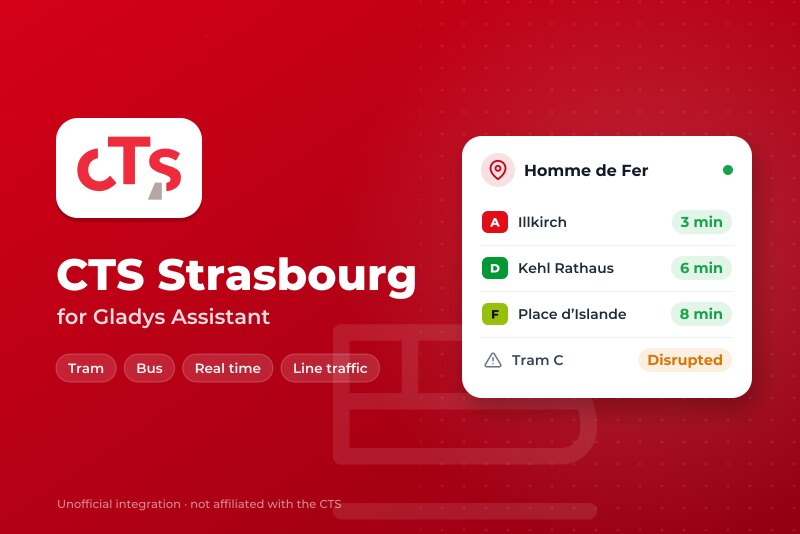
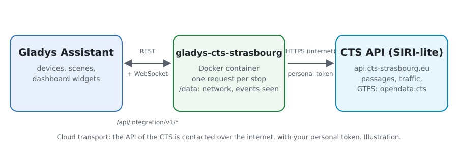
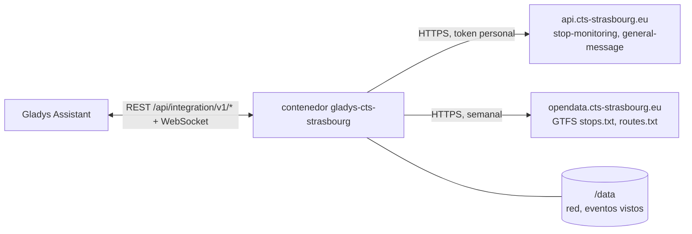
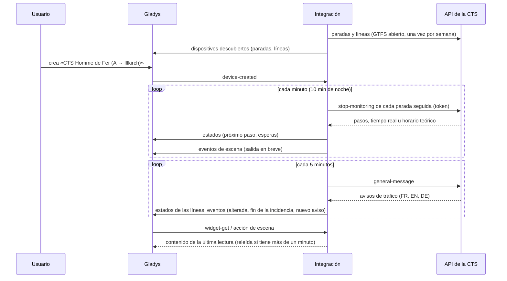
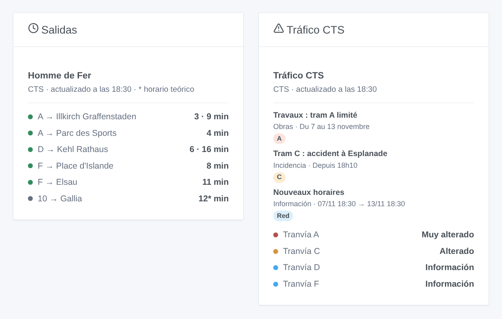

# Gladys CTS Strasbourg

[English](README.md) · [Français](README.fr.md) · [Deutsch](README.de.md) · **Español**

[](LICENSE)
[](https://github.com/William-De71/gladys-cts-strasbourg/releases)
[](https://github.com/William-De71/gladys-cts-strasbourg/actions/workflows/release.yml)
[](https://gladysassistant.com)



Integración externa de [Gladys Assistant](https://gladysassistant.com) para la **CTS**, los tranvías y autobuses de Estrasburgo: los próximos pasos en tiempo real en tus paradas y el tráfico de tus líneas, con escenas y widgets de panel. Lee la API oficial en tiempo real de la Compagnie des Transports Strasbourgeois (SIRI-lite), con tu token personal.

Documentación de usuario: [English](docs/en.md) · [Français](docs/fr.md) · [Deutsch](docs/de.md) · [Español](docs/es.md).

> Integración comunitaria, sin relación con la Compagnie des Transports Strasbourgeois ni la Eurometrópolis de Estrasburgo, ni respaldada por ellas.

> **Aún no probada con un token real.** El código sigue la descripción publicada de la API (`swagger.json`), y las pruebas usan respuestas construidas a partir de ella. Los comentarios de un usuario con token son bienvenidos.

## Funciones

- **Un dispositivo por parada seguida** (tres en el formulario, hasta 7 más con el botón **Añadir una parada**), escrita por nombre o código («275» para toda la parada, «275A» para un andén) y filtrada por **línea** («A», «C1», «2», o «tram», «bus») y **dirección**: próximo paso, espera de los dos próximos pasos, número de avisos de tráfico sobre sus líneas.
- **Un dispositivo por línea seguida**: su estado de tráfico (normal, información, alterado, muy alterado) y su número de avisos de tráfico.
- **Tiempo real**: la hora estimada cuando el vehículo se sigue en directo, el horario teórico si no (marcado como tal).
- **4 disparadores**, **2 acciones de escena** y **2 widgets de panel** (abajo).
- **Respetuosa con la API**: una petición por parada, respuestas guardadas mientras su `cache-control` lo indique, pausa de 5 minutos tras un 429, menos lecturas de noche.
- **Búsqueda de paradas sin gastar peticiones**: los nombres y códigos proceden del GTFS abierto de la CTS, leído cada semana y guardado en `/data`.
- Botones de configuración: probar la conexión, buscar una parada, añadir / quitar / listar paradas, diagnóstico (sin el token).
- Cuatro idiomas en todo: inglés, francés, alemán, español.

## Funcionamiento





Al arrancar, la integración lee las paradas y líneas del GTFS abierto de la CTS (solo `stops.txt` y `routes.txt` del zip): un `stop_code` «275A» es un andén de Homme de Fer, su código lógico «275» toda la parada. Resuelve lo que escribiste y luego lee cada parada seguida (`siri/2.0/stop-monitoring?MonitoringRef=275`) con su propio temporizador, y el tráfico de la red (`siri/2.0/general-message`) cada 5 minutos. Cada lectura se compara con la anterior para disparar las escenas.



### Transporte

Solo cloud (`"transports": ["cloud"]`): el catálogo muestra la insignia cloud. La integración contacta `api.cts-strasbourg.eu` (con tu token y los códigos de tus paradas) y `opendata.cts-strasbourg.eu`. No hay vía local, así que no hay botón «Preferir la conexión local».

## Dispositivos y funciones

| Dispositivo                | Función                         | Categoría / tipo             | Valores                                   |
| -------------------------- | ------------------------------- | ---------------------------- | ----------------------------------------- |
| CTS \<parada\>             | Próximo paso                    | `text` / `text`              | «A → Illkirch Graffenstaden · 3 min»      |
| CTS \<parada\>             | Espera, espera del siguiente    | `duration` / `integer`       | 0 … 180 min                               |
| CTS \<parada\>             | Avisos de tráfico de sus líneas | `counter-sensor` / `integer` | 0 … 20                                    |
| CTS tranvía A, CTS línea 2 | Tráfico                         | `text` / `text`              | «Alterado: Tram C : accident à Esplanade» |
| CTS tranvía A, CTS línea 2 | Avisos de tráfico               | `counter-sensor` / `integer` | 0 … 20                                    |

De noche, sin pasos, las esperas conservan su último valor (un 0 anunciaría un tranvía ahora). La API no da retrasos ni viajes suprimidos: la integración no los inventa.

## Disparadores, acciones de escena y widgets



**Disparadores de escena** (una vez por transición; la primera lectura es una referencia y no dispara nada):

- **Salida en breve**: un tranvía o autobús en una parada seguida sale dentro de 2, 3, 5, 10, 15 o 20 minutos. Filtros: parada, minutos.
- **Línea alterada**: una línea seguida pasa a alterada o muy alterada. Filtro: línea.
- **Fin de la incidencia**: una línea seguida que estaba alterada vuelve a la normalidad. Filtro: línea.
- **Nuevo aviso de tráfico**: un nuevo aviso sobre una línea seguida, las líneas de una parada seguida o toda la red; una actualización vuelve a disparar cuando la CTS pide notificarla. Filtros: línea o parada, tipo, prioridad.

**Acciones de escena**: **próximas salidas** de una parada (línea, destino, espera, hora, tiempo real o no, el siguiente, una frase) y **tráfico de una línea** (estado, alterada o no, número de avisos, último aviso, una frase).

**Widgets**: **Salidas** (una parada seguida, varias en una lista, o cualquier parada escrita en los ajustes) y **Tráfico CTS** (las líneas seguidas, las líneas escritas, o las líneas de tranvía).

Ejemplos:

- Cuando **el tranvía A hacia Illkirch sale de Homme de Fer dentro de 5 minutos** → encender en verde la lámpara de la entrada.
- Cuando **el tranvía C pasa a alterado** → enviar `{{triggerEvent.data.summary}}` a tu teléfono.
- Cada día laborable a las 7:30 → **leer las próximas salidas** de tu parada y hacer que el altavoz de la cocina diga el `summary`.

## Requisitos

- Gladys Assistant **5.3.0** o posterior (widgets y disparadores de las integraciones externas, palabras clave y países del catálogo de Gladys 5.3). Las instancias más antiguas no pueden instalar la integración.
- Un token personal y gratuito de la API de la CTS: solicita el acceso al portal open data por correo a `open-data@cts-strasbourg.fr`.

## Instalación

- **Desde la tienda** de Gladys (Integraciones → Integraciones externas), en un clic, una vez indexada.
- **Desde la URL del repositorio**: `https://github.com/William-De71/gladys-cts-strasbourg`.
- **Modo desarrollador**: construye la imagen en local (`docker build -t gladys-cts-strasbourg .`) e instálala desde Gladys.

## Configuración

| Campo                  | Descripción                                                                            |
| ---------------------- | -------------------------------------------------------------------------------------- |
| Token                  | El token de tu cuenta open data de la CTS (secreto, nunca registrado).                 |
| Parada (1 a 3)         | Un nombre («Homme de Fer», «Gare Centrale») o un código («275», «275A»).               |
| Línea                  | «A», «C1», «2», o «tram», «bus». Vacío: todas las líneas de la parada.                 |
| Dirección              | Palabras del destino: «Illkirch», «Illkirch \| Lixenbuhl». Vacío: ambas.               |
| Líneas seguidas        | «A, C, 2, C1» (hasta 10): un dispositivo por línea, con su tráfico.                    |
| Lectura de las paradas | 30 s, 1 min (por defecto), 2 min o 5 min; 10 min de noche.                             |
| Idioma de los textos   | Nombres de los dispositivos, resúmenes y salidas de las escenas, idioma de los avisos. |

Botones: **Probar la conexión**, **Buscar una parada** (en el GTFS abierto, sin gastar peticiones), **Añadir una parada**, **Quitar una parada**, **Listar las paradas** (las paradas más allá de las tres del formulario, guardadas en la configuración de Gladys) y **Diagnóstico** (escribe las paradas, líneas, últimos pasos, avisos de tráfico, errores y peticiones en la pestaña Registros, nunca el token).

## Uso

1. Pide un token a la CTS, pégalo, escribe de una a tres paradas — más con **Añadir una parada** — (con su línea y dirección si quieres) y las líneas a seguir, y guarda.
2. En la pestaña **Descubrir**, crea los dispositivos «CTS …».
3. Añade los widgets **Salidas** y **Tráfico CTS** a un panel, y construye escenas con los disparadores de arriba.

## Desarrollo

```bash
npm install
npm test                       # node --test, nunca toca la red
npm run lint && npm run format:check
npx github:GladysAssistant/integration-store . --skip-image-check
scripts/build-cover.sh         # cover.jpg desde docs/assets/cover.svg
docs/illustrations/render.sh   # docs/assets/widgets.<lang>.png
node .github/scripts/release.mjs next
```

En local, el SDK lee `GLADYS_HOST_API_URL`, `GLADYS_INTEGRATION_TOKEN` y `GLADYS_INTEGRATION_SELECTOR`; `CTS_API_URL` y `CTS_GTFS_URL` dirigen la integración a otras raíces (un simulacro); `DEBUG=gladys-integration-sdk` muestra los registros del SDK y comprueba cada contenido de widget. Las pruebas usan respuestas construidas a partir de la descripción OpenAPI de la API y extractos del GTFS real (`test/fixtures/`, Licence Ouverte 2.0). Las reglas del proyecto están en [CLAUDE.md](CLAUDE.md).

## Proceso de release


Cada fusión en `main` lanza la CI y calcula la versión a partir de los [Conventional Commits](https://www.conventionalcommits.org/es/) desde la última etiqueta: `feat` → menor, `fix` / `perf` → parche, `!` o `BREAKING CHANGE` → mayor (una menor por debajo de 1.0.0); `docs`, `chore`, `ci`, `test`, `style`, `refactor`, `build` solos no publican nada. Se genera la sección del changelog, se empuja la etiqueta, se construye la imagen multiarquitectura, luego `main` recibe el commit de release, se crea la GitHub Release y un último job comprueba la imagen pública, el validador de la tienda y el topic.

- El título de la pull request se convierte en el commit squash y luego en la línea del changelog: escríbelo en inglés, para el usuario (`pr-title.yml` lo comprueba). Nunca edites `CHANGELOG.md` a mano.
- La 1.0.0 es una decisión: Actions → Release → Run workflow con `release-as: 1.0.0`. `dry-run` muestra la versión y las notas sin publicar.
- **Rama protegida**: la release empuja su commit a `main` con `GITHUB_TOKEN`. Con un ruleset en `main` más estricto que «sin borrado, sin force-push», añade GitHub Actions a su lista de omisión (o empuja mediante una GitHub App); si no, el job de publicación falla con instrucciones.
- Tras la primera release, haz público el paquete `ghcr.io` (Package settings → Change visibility); si no, Gladys no puede descargarlo.

## Solución de problemas

Consulta [docs/es.md](docs/es.md#solución-de-problemas). Informa de los problemas con las versiones de Gladys y de la integración, la parada o línea afectada y las líneas del botón **Diagnóstico**.

## Contribuir

Issues y pull requests bienvenidos. Ejecuta `npm run format:check && npm run lint && npm test` antes de abrir una pull request y mantén sin cambios todos los external ids y claves guardadas (consulta [CLAUDE.md](CLAUDE.md)).

## Seguridad

Consulta [SECURITY.md](SECURITY.md): informa de las vulnerabilidades en privado. El token es un secreto de la configuración: solo se envía a la API de la CTS y nunca se escribe en los registros, el diagnóstico ni los mensajes de error. El contenedor funciona en solo lectura, con un usuario no root.

## Capturas pendientes

Las imágenes de arriba son ilustraciones, no capturas de pantalla. Las capturas reales irán en `docs/assets/screenshots/` (PNG, 1280 × 800): `configuration.png`, `discovery.png`, `device.png`, `scene.png`.

## Licencia

[Licencia Apache 2.0](LICENSE) — consulta también [NOTICE](NOTICE). Los pasos, los avisos de tráfico y las paradas son datos de la CTS con [Licence Ouverte 2.0](https://www.etalab.gouv.fr/licence-ouverte-open-licence/): los widgets muestran la fuente y la hora de cada lectura. Gracias a la documentación y al SDK de Gladys, y a la CTS por abrir su API en tiempo real.
