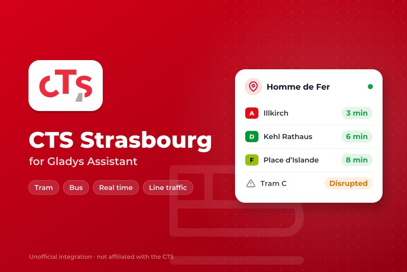
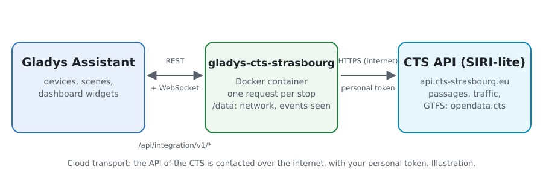
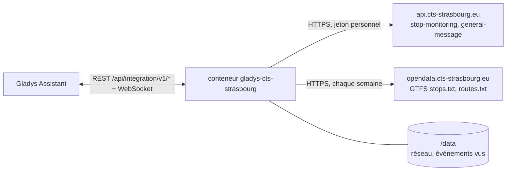
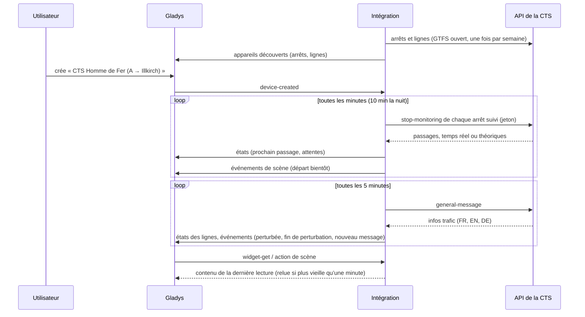
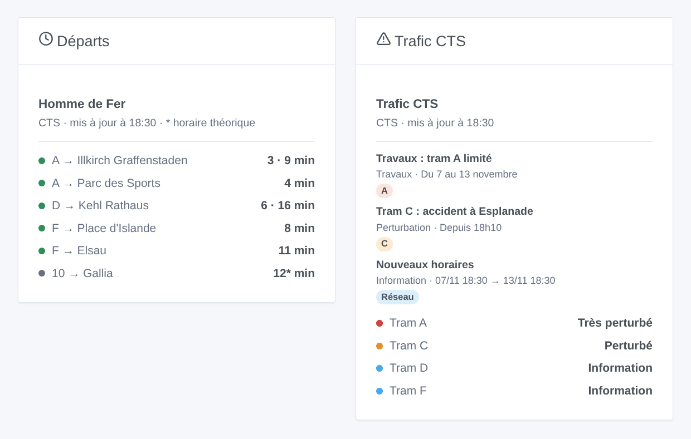

# Gladys CTS Strasbourg

[English](README.md) · **Français** · [Deutsch](README.de.md) · [Español](README.es.md)

[](LICENSE)
[](https://github.com/William-De71/gladys-cts-strasbourg/releases)
[](https://github.com/William-De71/gladys-cts-strasbourg/actions/workflows/release.yml)
[](https://gladysassistant.com)



Intégration externe [Gladys Assistant](https://gladysassistant.com) pour la **CTS**, les trams et bus de Strasbourg : les prochains passages en temps réel à vos arrêts et le trafic de vos lignes, avec scènes et widgets de tableau de bord. Elle lit l’API temps réel officielle de la Compagnie des Transports Strasbourgeois (SIRI-lite), avec votre jeton personnel.

Documentation utilisateur : [English](docs/en.md) · [Français](docs/fr.md) · [Deutsch](docs/de.md) · [Español](docs/es.md).

> Intégration communautaire, ni affiliée à ni approuvée par la Compagnie des Transports Strasbourgeois ou l’Eurométropole de Strasbourg.

> **Pas encore testée avec un vrai jeton.** Le code suit la description publiée de l’API (`swagger.json`), et les tests utilisent des réponses construites d’après elle. Les retours d’un utilisateur muni d’un jeton sont les bienvenus.

## Fonctionnalités

- **Un appareil par arrêt suivi** (trois dans le formulaire, jusqu’à 7 de plus avec le bouton **Ajouter un arrêt**), saisi par son nom ou son code (« 275 » pour tout l’arrêt, « 275A » pour un quai) et filtré par **ligne** (« A », « C1 », « 2 », ou « tram », « bus ») et **direction** : prochain passage, attente des deux prochains passages, nombre d’infos trafic sur ses lignes.
- **Un appareil par ligne suivie** : son état de trafic (normal, information, perturbé, très perturbé) et son nombre d’infos trafic.
- **Temps réel** : l’heure estimée quand le véhicule est suivi en direct, l’horaire théorique sinon (signalé comme tel).
- **4 déclencheurs**, **2 actions de scène** et **2 widgets de tableau de bord** (ci-dessous).
- **Respectueuse de l’API** : une requête par arrêt, réponses gardées aussi longtemps que leur `cache-control` le dit, pause de 5 minutes après un 429, moins de lectures la nuit.
- **Recherche d’arrêts sans consommer de requête** : les noms et codes viennent du GTFS ouvert de la CTS, lu chaque semaine et gardé dans `/data`.
- Boutons de configuration : tester la connexion, chercher un arrêt, ajouter / retirer / lister les arrêts, diagnostic (sans le jeton).
- Quatre langues partout : anglais, français, allemand, espagnol.

## Fonctionnement





Au démarrage, l’intégration lit les arrêts et lignes du GTFS ouvert de la CTS (seulement `stops.txt` et `routes.txt` du zip) : un `stop_code` « 275A » est un quai d’Homme de Fer, son code logique « 275 » tout l’arrêt. Elle résout ce que vous avez saisi, puis lit chaque arrêt suivi (`siri/2.0/stop-monitoring?MonitoringRef=275`) sur son propre minuteur, et le trafic du réseau (`siri/2.0/general-message`) toutes les 5 minutes. Chaque lecture est comparée à la précédente pour déclencher les scènes.



### Transport

Cloud uniquement (`"transports": ["cloud"]`) : le catalogue affiche le badge cloud. L’intégration contacte `api.cts-strasbourg.eu` (avec votre jeton et les codes de vos arrêts) et `opendata.cts-strasbourg.eu`. Il n’existe pas de voie locale, donc pas de bouton « Préférer la connexion locale ».

## Appareils et fonctionnalités

| Appareil                | Fonctionnalité              | Catégorie / type             | Valeurs                                      |
| ----------------------- | --------------------------- | ---------------------------- | -------------------------------------------- |
| CTS \<arrêt\>           | Prochain passage            | `text` / `text`              | « A → Illkirch Graffenstaden · 3 min »       |
| CTS \<arrêt\>           | Attente, attente du suivant | `duration` / `integer`       | 0 … 180 min                                  |
| CTS \<arrêt\>           | Infos trafic de ses lignes  | `counter-sensor` / `integer` | 0 … 20                                       |
| CTS tram A, CTS ligne 2 | Trafic                      | `text` / `text`              | « Perturbé : Tram C : accident à Esplanade » |
| CTS tram A, CTS ligne 2 | Infos trafic                | `counter-sensor` / `integer` | 0 … 20                                       |

La nuit, sans passage, les attentes gardent leur dernière valeur (un 0 annoncerait un tram maintenant). L’API ne donne ni retard ni course supprimée : l’intégration n’en invente pas.

## Déclencheurs, actions de scène et widgets



**Déclencheurs de scène** (une fois par transition ; la première lecture sert de référence et ne déclenche rien) :

- **Départ bientôt** : un tram ou un bus à un arrêt suivi part dans 2, 3, 5, 10, 15 ou 20 minutes. Filtres : arrêt, minutes.
- **Ligne perturbée** : une ligne suivie devient perturbée ou très perturbée. Filtre : ligne.
- **Fin de perturbation** : une ligne suivie qui était perturbée revient à la normale. Filtre : ligne.
- **Nouveau message trafic** : un nouveau message sur une ligne suivie, les lignes d’un arrêt suivi ou tout le réseau ; une mise à jour se déclenche à nouveau quand la CTS demande de la notifier. Filtres : ligne ou arrêt, type, priorité.

**Actions de scène** : **prochains départs** d’un arrêt (ligne, destination, attente, heure, temps réel ou non, le suivant, une phrase) et **trafic d’une ligne** (état, perturbée ou non, nombre de messages, dernier message, une phrase).

**Widgets** : **Départs** (un arrêt suivi, plusieurs dans une même liste, ou n’importe quel arrêt saisi dans les réglages) et **Trafic CTS** (les lignes suivies, les lignes saisies, ou les lignes de tram).

Exemples :

- Quand **le tram A vers Illkirch part d’Homme de Fer dans 5 minutes** → allumer la lampe de l’entrée en vert.
- Quand **le tram C devient perturbé** → envoyer `{{triggerEvent.data.summary}}` sur votre téléphone.
- Chaque jour de semaine à 7 h 30 → **lire les prochains départs** de votre arrêt et faire dire le `summary` par l’enceinte de la cuisine.

## Prérequis

- Gladys Assistant **5.3.0** ou plus récent (widgets et déclencheurs des intégrations externes, mots-clés et pays du catalogue de Gladys 5.3). Les instances plus anciennes ne peuvent pas installer l’intégration.
- Un jeton personnel de l’API de la CTS, gratuit : demandez l’accès au portail open data par e-mail à `open-data@cts-strasbourg.fr`.

## Installation

- **Depuis le store** de Gladys (Intégrations → Intégrations externes), en un clic, une fois indexée.
- **Depuis l’URL du dépôt** : `https://github.com/William-De71/gladys-cts-strasbourg`.
- **Mode développeur** : construisez l’image en local (`docker build -t gladys-cts-strasbourg .`) et installez-la depuis Gladys.

## Configuration

| Champ              | Description                                                                            |
| ------------------ | -------------------------------------------------------------------------------------- |
| Jeton              | Le jeton de votre compte open data de la CTS (secret, jamais journalisé).              |
| Arrêt (1 à 3)      | Un nom (« Homme de Fer », « Gare Centrale ») ou un code (« 275 », « 275A »).           |
| Ligne              | « A », « C1 », « 2 », ou « tram », « bus ». Vide : toutes les lignes de l’arrêt.       |
| Direction          | Des mots de la destination : « Illkirch », « Illkirch \| Lixenbuhl ». Vide : les deux. |
| Lignes suivies     | « A, C, 2, C1 » (jusqu’à 10) : un appareil par ligne, avec son trafic.                 |
| Lecture des arrêts | 30 s, 1 min (par défaut), 2 min ou 5 min ; 10 min la nuit.                             |
| Langue des textes  | Noms des appareils, résumés et sorties des scènes, langue des infos trafic.            |

Boutons : **Tester la connexion**, **Chercher un arrêt** (dans le GTFS ouvert, sans consommer de requête), **Ajouter un arrêt**, **Retirer un arrêt**, **Lister les arrêts** (les arrêts au-delà des trois du formulaire, gardés dans la configuration de Gladys) et **Diagnostic** (écrit les arrêts, lignes, derniers passages, infos trafic, erreurs et requêtes dans l’onglet Journaux, jamais le jeton).

## Utilisation

1. Demandez un jeton à la CTS, collez-le, saisissez un à trois arrêts — plus avec **Ajouter un arrêt** — (avec leur ligne et direction si vous voulez) et les lignes à suivre, puis enregistrez.
2. Dans l’onglet **Découvrir**, créez les appareils « CTS … ».
3. Ajoutez les widgets **Départs** et **Trafic CTS** à un tableau de bord, et construisez des scènes avec les déclencheurs ci-dessus.

## Développement

```bash
npm install
npm test                       # node --test, ne touche jamais le réseau
npm run lint && npm run format:check
npx github:GladysAssistant/integration-store . --skip-image-check
scripts/build-cover.sh         # cover.jpg depuis docs/assets/cover.svg
docs/illustrations/render.sh   # docs/assets/widgets.<lang>.png
node .github/scripts/release.mjs next
```

En local, le SDK lit `GLADYS_HOST_API_URL`, `GLADYS_INTEGRATION_TOKEN` et `GLADYS_INTEGRATION_SELECTOR` ; `CTS_API_URL` et `CTS_GTFS_URL` dirigent l’intégration vers d’autres racines (une maquette) ; `DEBUG=gladys-integration-sdk` affiche les journaux du SDK et vérifie chaque contenu de widget. Les tests utilisent des réponses construites d’après la description OpenAPI de l’API et des extraits du vrai GTFS (`test/fixtures/`, Licence Ouverte 2.0). Les règles du projet sont dans [CLAUDE.md](CLAUDE.md).

## Processus de release


Chaque fusion sur `main` lance la CI, puis calcule la version à partir des [Conventional Commits](https://www.conventionalcommits.org/fr/) depuis le dernier tag : `feat` → mineure, `fix` / `perf` → correctif, `!` ou `BREAKING CHANGE` → majeure (une mineure sous 1.0.0) ; `docs`, `chore`, `ci`, `test`, `style`, `refactor`, `build` seuls ne publient rien. La section du changelog est générée, le tag poussé, l’image multi-architecture construite, puis `main` reçoit le commit de release, la GitHub Release est créée et un dernier job vérifie l’image publique, le validateur du store et le topic.

- Le titre de la pull request devient le commit squash, puis la ligne du changelog : rédigez-le en anglais, pour l’utilisateur (`pr-title.yml` le vérifie). N’éditez jamais `CHANGELOG.md` à la main.
- La 1.0.0 est une décision : Actions → Release → Run workflow avec `release-as: 1.0.0`. `dry-run` affiche la version et les notes sans publier.
- **Branche protégée** : la release pousse son commit sur `main` avec `GITHUB_TOKEN`. Avec un ruleset sur `main` plus strict que « pas de suppression, pas de force-push », ajoutez GitHub Actions à sa liste de contournement (ou poussez via une GitHub App), sinon le job de publication échoue avec des instructions.
- Après la première release, rendez le paquet `ghcr.io` public (Package settings → Change visibility), sinon Gladys ne peut pas le télécharger.

## Dépannage

Voir [docs/fr.md](docs/fr.md#dépannage). Signalez les problèmes avec les versions de Gladys et de l’intégration, l’arrêt ou la ligne concernés et les lignes du bouton **Diagnostic**.

## Contribuer

Issues et pull requests bienvenues. Lancez `npm run format:check && npm run lint && npm test` avant d’ouvrir une pull request, et gardez inchangés tous les external ids et les clés stockées (voir [CLAUDE.md](CLAUDE.md)).

## Sécurité

Voir [SECURITY.md](SECURITY.md) : signalez les vulnérabilités en privé. Le jeton est un secret de la configuration : il n’est envoyé qu’à l’API de la CTS et n’est jamais écrit dans les journaux, le diagnostic ou les messages d’erreur. Le conteneur tourne en lecture seule, avec un utilisateur non root.

## Captures à venir

Les images ci-dessus sont des illustrations, pas des captures d’écran. Les vraies captures iront dans `docs/assets/screenshots/` (PNG, 1280 × 800) : `configuration.png`, `discovery.png`, `device.png`, `scene.png`.

## Licence

[Licence Apache 2.0](LICENSE) — voir aussi [NOTICE](NOTICE). Les passages, les infos trafic et les arrêts sont des données de la CTS sous [Licence Ouverte 2.0](https://www.etalab.gouv.fr/licence-ouverte-open-licence/) : les widgets affichent la source et l’heure de chaque lecture. Merci à la documentation et au SDK de Gladys, et à la CTS d’avoir ouvert son API temps réel.
