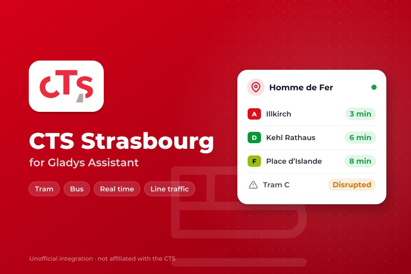
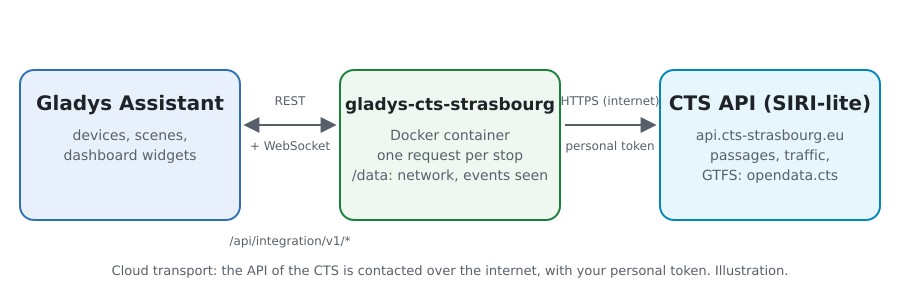
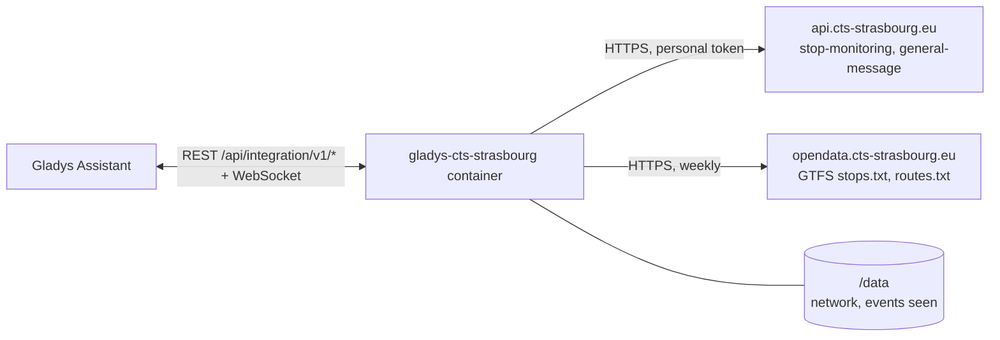
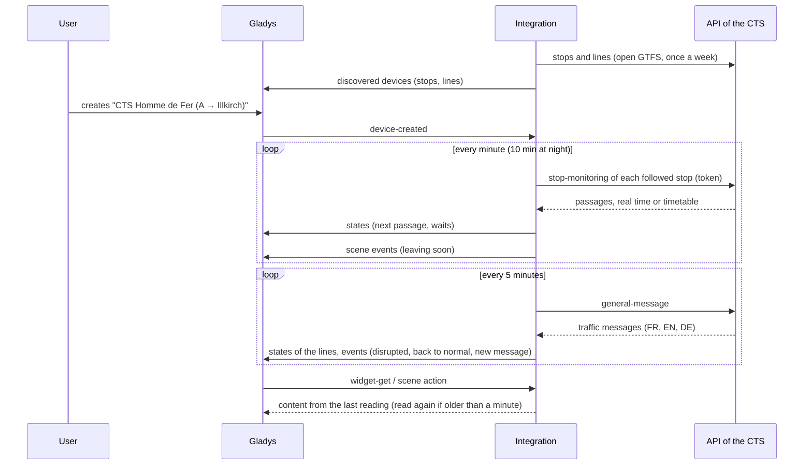
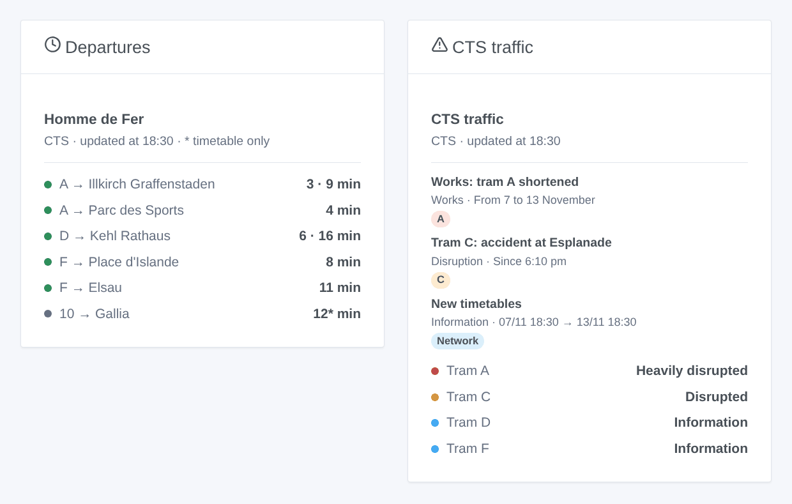

# Gladys CTS Strasbourg

**English** · [Français](README.fr.md) · [Deutsch](README.de.md) · [Español](README.es.md)

[](LICENSE)
[](https://github.com/William-De71/gladys-cts-strasbourg/releases)
[](https://github.com/William-De71/gladys-cts-strasbourg/actions/workflows/release.yml)
[](https://gladysassistant.com)



[Gladys Assistant](https://gladysassistant.com) external integration for the **CTS**, the trams and buses of Strasbourg: the next passages in real time at your stops and the traffic of your lines, with scenes and dashboard widgets. It reads the official real-time API of the Compagnie des Transports Strasbourgeois (SIRI-lite), with your personal token.

User documentation: [English](docs/en.md) · [Français](docs/fr.md) · [Deutsch](docs/de.md) · [Español](docs/es.md).

> Community integration, not affiliated with nor endorsed by the Compagnie des Transports Strasbourgeois or the Eurométropole de Strasbourg.

> **Not yet tested with a real token.** The code follows the published description of the API (`swagger.json`), and the tests use answers built from it. Feedback from a user with a token is welcome.

## Features

- **One device per followed stop** (three in the form, up to 7 more with the **Add a stop** button), typed by name or by code ("275" for the whole stop, "275A" for one side) and filtered by **line** ("A", "C1", "2", or "tram", "bus") and **direction**: next passage, wait of the next two passages, number of traffic messages about its lines.
- **One device per followed line**: its traffic state (normal, information, disrupted, heavily disrupted) and its number of traffic messages.
- **Real time**: the estimated time when the vehicle is followed live, the timetable otherwise (marked as such).
- **4 scene triggers**, **2 scene actions** and **2 dashboard widgets** (below).
- **Polite with the API**: one request per stop, answers kept as long as their `cache-control` says, a pause of 5 minutes after a 429, fewer readings at night.
- **Stop search without spending a request**: the names and codes come from the open GTFS of the CTS, read weekly and kept in `/data`.
- Configuration buttons: test the connection, find a stop, add / remove / list stops, diagnostic (without the token).
- Four languages everywhere: English, French, German, Spanish.

## How it works





At start, the integration reads the stops and lines of the open GTFS of the CTS (only `stops.txt` and `routes.txt` of the zip): a `stop_code` "275A" is one side of Homme de Fer, its logical code "275" the whole stop. It resolves what you typed, then reads each followed stop (`siri/2.0/stop-monitoring?MonitoringRef=275`) on its own timer, and the traffic of the network (`siri/2.0/general-message`) every 5 minutes. Each reading is compared with the previous one to fire the scene triggers.



### Transport

Cloud only (`"transports": ["cloud"]`): the catalog shows the cloud badge. The integration contacts `api.cts-strasbourg.eu` (with your token and the codes of your stops) and `opendata.cts-strasbourg.eu`. There is no local alternative, so there is no "prefer the local connection" button.

## Devices and features

| Device                  | Feature                       | Category / type              | Values                                     |
| ----------------------- | ----------------------------- | ---------------------------- | ------------------------------------------ |
| CTS \<stop\>            | Next passage                  | `text` / `text`              | "A → Illkirch Graffenstaden · 3 min"       |
| CTS \<stop\>            | Wait, wait for the following  | `duration` / `integer`       | 0 … 180 min                                |
| CTS \<stop\>            | Traffic messages of its lines | `counter-sensor` / `integer` | 0 … 20                                     |
| CTS tram A, CTS ligne 2 | Traffic                       | `text` / `text`              | "Disrupted: Tram C: accident at Esplanade" |
| CTS tram A, CTS ligne 2 | Traffic messages              | `counter-sensor` / `integer` | 0 … 20                                     |

At night, without any passage, the waits keep their last value (a 0 would announce a tram now). The API gives no delay nor cancelled trip: the integration does not invent them.

## Scene triggers, actions and widgets



**Scene triggers** (once per transition; the first reading is a reference and fires nothing):

- **Departure soon**: a tram or bus at a followed stop leaves in 2, 3, 5, 10, 15 or 20 minutes. Filters: stop, minutes.
- **Line disrupted**: a followed line becomes disrupted or heavily disrupted. Filter: line.
- **Back to normal**: a followed line that was disrupted is back to normal. Filter: line.
- **New traffic message**: a new message about a followed line, the lines of a followed stop or the whole network; an update fires again when the CTS asks to notify it. Filters: line or stop, kind, priority.

**Scene actions**: **next departures** of a stop (line, destination, wait, time, real time or not, the following one, a sentence) and **traffic of a line** (state, disrupted or not, number of messages, latest message, a sentence).

**Widgets**: **Departures** (a followed stop, several in one list, or any stop typed in the settings) and **CTS traffic** (the followed lines, the lines typed, or the tram lines).

Examples:

- When **the tram A towards Illkirch leaves Homme de Fer in 5 minutes** → light the hall lamp in green.
- When **the tram C becomes disrupted** → send `{{triggerEvent.data.summary}}` to your phone.
- Every weekday at 7:30 → **read the next departures** of your stop and have the `summary` spoken by the kitchen speaker.

## Requirements

- Gladys Assistant **5.3.0** or later (widgets and scene triggers of external integrations, catalog keywords and countries of Gladys 5.3). Older instances cannot install the integration.
- A personal token of the API of the CTS, free: ask for access to the open data portal by e-mail to `open-data@cts-strasbourg.fr`.

## Installation

- **From the store** of Gladys (Integrations → External integrations), in one click, once indexed.
- **From the repository URL**: `https://github.com/William-De71/gladys-cts-strasbourg`.
- **Developer mode**: build the image locally (`docker build -t gladys-cts-strasbourg .`) and install it from Gladys.

## Configuration

| Field                 | Description                                                                  |
| --------------------- | ---------------------------------------------------------------------------- |
| Token                 | The token of your open data account of the CTS (secret, never logged).       |
| Stop (1 to 3)         | A name ("Homme de Fer", "Gare Centrale") or a code ("275", "275A").          |
| Line                  | "A", "C1", "2", or "tram", "bus". Empty: every line of the stop.             |
| Direction             | Words of the destination: "Illkirch", "Illkirch \| Lixenbuhl". Empty: both.  |
| Followed lines        | "A, C, 2, C1" (up to 10): one device per line with its traffic.              |
| Reading of the stops  | 30 s, 1 min (default), 2 min or 5 min; 10 min at night.                      |
| Language of the texts | Device names, scene summaries and outputs, language of the traffic messages. |

Buttons: **Test the connection**, **Find a stop** (from the open GTFS, without spending a request), **Add a stop**, **Remove a stop**, **List the stops** (the stops beyond the three of the form, kept in the Gladys configuration) and **Diagnostic** (writes the stops, lines, last passages, traffic messages, errors and requests to the Logs tab, never the token).

## Usage

1. Ask the CTS for a token, paste it, enter one to three stops — more with **Add a stop** — (with their line and direction if you wish) and the lines to follow, then save.
2. In the **Discover** tab, create the "CTS …" devices.
3. Add the **Departures** and **CTS traffic** widgets to a dashboard, and build scenes with the triggers above.

## Development

```bash
npm install
npm test                       # node --test, never touches the network
npm run lint && npm run format:check
npx github:GladysAssistant/integration-store . --skip-image-check
scripts/build-cover.sh         # cover.jpg from docs/assets/cover.svg
docs/illustrations/render.sh   # docs/assets/widgets.<lang>.png
node .github/scripts/release.mjs next
```

Locally, the SDK reads `GLADYS_HOST_API_URL`, `GLADYS_INTEGRATION_TOKEN` and `GLADYS_INTEGRATION_SELECTOR`; `CTS_API_URL` and `CTS_GTFS_URL` point the integration to other roots (a mock); `DEBUG=gladys-integration-sdk` shows the SDK logs and checks every widget content. The tests use answers built from the OpenAPI description of the API and extracts of the real GTFS (`test/fixtures/`, Licence Ouverte 2.0). The rules of the project are in [CLAUDE.md](CLAUDE.md).

## Release process


Every merge on `main` runs the CI, then computes the version from the [Conventional Commits](https://www.conventionalcommits.org/) since the last tag: `feat` → minor, `fix` / `perf` → patch, `!` or `BREAKING CHANGE` → major (a minor below 1.0.0); `docs`, `chore`, `ci`, `test`, `style`, `refactor`, `build` alone publish nothing. The changelog section is generated, the tag pushed, the multi-architecture image built, then `main` receives the release commit, the GitHub Release is created and a last job checks the public image, the store validator and the topic.

- The pull request title becomes the squash commit, then the changelog line: write it in English, for the user (`pr-title.yml` checks it). Never edit `CHANGELOG.md` by hand.
- 1.0.0 is a decision: Actions → Release → Run workflow with `release-as: 1.0.0`. `dry-run` shows the version and the notes without publishing.
- **Protected branch**: the release pushes its commit to `main` with `GITHUB_TOKEN`. With a ruleset on `main` stricter than "no deletion, no force-push", add GitHub Actions to its bypass list (or push through a GitHub App), otherwise the publish job fails with instructions.
- After the first release, make the `ghcr.io` package public (Package settings → Change visibility), or Gladys cannot pull it.

## Troubleshooting

See [docs/en.md](docs/en.md#troubleshooting). Report issues with the versions of Gladys and of the integration, the stop or line concerned, and the lines of the **Diagnostic** button.

## Contributing

Issues and pull requests are welcome. Run `npm run format:check && npm run lint && npm test` before opening a pull request, and keep every external id and stored key unchanged (see [CLAUDE.md](CLAUDE.md)).

## Security

See [SECURITY.md](SECURITY.md): report vulnerabilities privately. The token is a secret of the configuration: it is only sent to the API of the CTS and never written in the logs, the diagnostic or the error messages. The container runs read-only, as a non-root user.

## Screenshots to come

The images above are illustrations, not screenshots. Real screenshots will go in `docs/assets/screenshots/` (PNG, 1280 × 800): `configuration.png`, `discovery.png`, `device.png`, `scene.png`.

## License

[Apache License 2.0](LICENSE) — see also [NOTICE](NOTICE). The passages, the traffic messages and the stops are data of the CTS under the [Licence Ouverte 2.0](https://www.etalab.gouv.fr/licence-ouverte-open-licence/): the widgets show the source and the time of each reading. Thanks to the Gladys documentation and SDK, and to the CTS for opening its real-time API.
