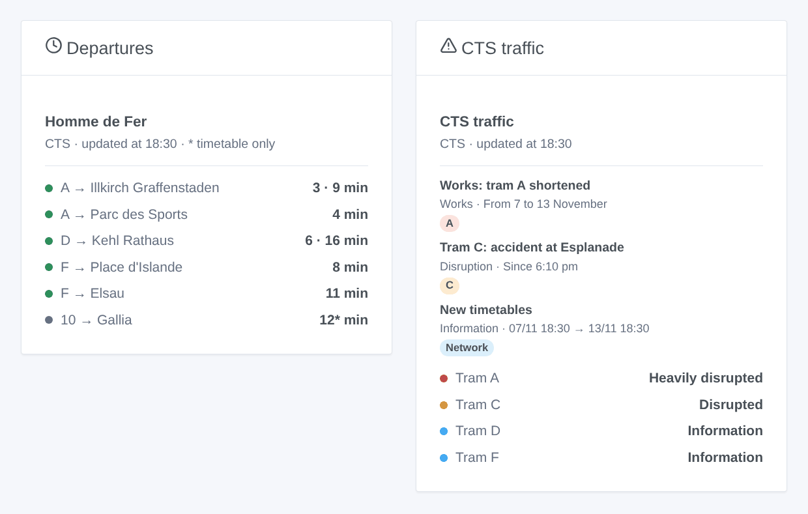

# CTS Strasbourg

## Overview

This integration brings the **trams and buses of Strasbourg** (CTS, Compagnie des Transports Strasbourgeois) into Gladys. It gives the **next passages in real time** at the stops you choose (three in the form, up to 7 more with a button), filtered by line and direction, and the **traffic of the lines** you follow: normal service, disrupted, heavily disrupted, with the traffic messages of the CTS (disruptions, works, information). Each stop and each line becomes a device to show on a dashboard and to use in scenes.

The data come from the **official real-time API of the CTS** (SIRI-lite), under the Licence Ouverte 2.0. It needs a **personal token**, free: the CTS gives access to its open data portal on request. The names and codes of the stops and lines come from the open timetable of the CTS (GTFS), read once a week: finding a stop never spends a request.

Each followed stop is one request per reading, every minute by default; the traffic is read every 5 minutes. The integration keeps every answer as long as the API says it stays valid, and pauses 5 minutes if the API asks to slow down. At night, while no stop announces anything in the next 45 minutes, the stops are read every 10 minutes.

A passage is **followed in real time** when the CTS knows where the vehicle is; otherwise it is the **timetable**, marked "(timetable)" (a star in the widget). The API gives no delay and no cancelled trip: the integration never invents one.

This is a **cloud** integration: it contacts `api.cts-strasbourg.eu` (with your token and the codes of your stops) and `opendata.cts-strasbourg.eu` (the open timetable). Nothing else leaves your network.

The integration was written from the published description of the API (swagger.json); it has not yet been tested with a real token. Your feedback is welcome.

## Requirements

- Gladys Assistant 5.3.0 or later.
- A personal token of the API of the CTS: ask for access to the open data portal by e-mail to `open-data@cts-strasbourg.fr`, with a few words on your use (for example "Gladys Assistant home automation"), then copy the token shown in your open data account.

## Configuration

| Field                 | What to type                                                                                                               |
| --------------------- | -------------------------------------------------------------------------------------------------------------------------- |
| Token                 | The token of your open data account of the CTS. Stored as a secret, never written in the logs.                             |
| Stop 1, 2, 3          | The name of the stop ("Homme de Fer", "Gare Centrale") or its code: "275" for the whole stop, "275A" for one side.         |
| Line                  | Only this line: "A", "C1", "2", or a mode alone: "tram", "bus". Empty: every line of the stop.                             |
| Direction             | Only the destinations holding these words: "Illkirch", "Illkirch \| Lixenbuhl". Empty: both directions.                    |
| Followed lines        | The lines whose traffic you follow, separated by commas: "A, C, 2, C1" (up to 10). One device per line.                    |
| Reading of the stops  | Every 30 seconds, minute (default), 2 minutes or 5 minutes.                                                                |
| Language of the texts | Names of the devices, summaries and outputs of the scenes, and language of the traffic messages (French, English, German). |

The **Find a stop** button gives the stops holding a few words, with their codes: "Homme de Fer [275] (275A, 275B, 275C, 275D)". The number is the whole stop, every direction; with its letter, one side of the road only. **Test the connection** reads the stops and lines of the CTS, each followed stop and the traffic right away, and says what answered.

More stops than the three of the form (home, work, school…): **Add a stop** takes the same three fields — stop, line, direction — and follows up to 7 more stops. **List the stops** shows every followed stop, numbered; **Remove a stop** takes that number (or the name). The added stops are kept in the configuration of Gladys, so they follow its backups.

## Usage

### Devices

In the **Discover** tab, create the devices you want:

- **CTS \<stop\>**: the next passage as text ("A → Illkirch Graffenstaden · 3 min"), the wait of the next passage and of the one after (minutes), and the number of traffic messages under way about the lines of the stop (those of the whole network included). At night, without any passage, the waits keep their last value.
- **CTS tram A**, **CTS ligne 2**: the traffic of the line as text ("Disrupted: Tram C: accident at Esplanade") and its number of traffic messages under way.

### Traffic of the lines

The state of a line is its heaviest message under way: a **disruption** makes it disrupted (heavily disrupted when the CTS marks it urgent), a **planned disruption** disrupted, **works** disrupted or heavily disrupted when they divert or interrupt the line, an **information** leaves the service normal. A message about the whole network counts for every line. The texts of the CTS exist in French, English and German.

### Dashboard widgets

- **Departures**: the next passages of a stop, compact. One row per line and destination, with its next passages in a row ("3 · 9 min"); a star marks a time of the timetable only. The **Routes shown** setting sets the number of rows. Choose a followed stop, or type any stop (and a line) in the widget settings: such a stop costs one more request at each refresh, every minute at most. With **Several stops**, one widget shows several stop devices.
- **CTS traffic**: the state of the followed lines (or of the lines typed in the settings, or the tram lines when none is followed), then their messages under way and coming. Tap a card for the full text.

### Scenes

Triggers, once per change (the first reading is only a baseline):

- **CTS: departure soon**: a tram or bus at a followed stop leaves in 2, 3, 5, 10, 15 or 20 minutes.
- **CTS: line disrupted**: a followed line becomes disrupted or heavily disrupted.
- **CTS: back to normal**: a followed line that was disrupted is back to normal.
- **CTS: new traffic message**: a new message about a followed line, the lines of a followed stop or the whole network; filters by kind (disruption, planned disruption, works, information) and priority. An update fires again when the CTS asks to notify it.

Each gives a ready-made sentence, `{{triggerEvent.data.summary}}`, and its values (line, destination, time, title, text, period…). The actions **CTS: next departures** and **CTS: traffic of a line** return the same kind of values, to put in a message or to test in a condition.

Examples:

- When the tram A towards Illkirch leaves Homme de Fer in 5 minutes → turn the hall lamp green.
- When the tram C becomes disrupted → send the summary to your phone before you leave.
- Every weekday at 7:30 → read the next passages of your stop and have the kitchen speaker announce them.

### Transport

Cloud only: the data come from the internet. Only the stops you follow are asked to the API, one by one, and the traffic of the network every 5 minutes.

## Troubleshooting

- **"Enter the token"**: the token is missing; ask for access at `open-data@cts-strasbourg.fr` and paste the token of your open data account in the configuration.
- **"The CTS API refuses the token"**: check it (no space before or after); the integration does not ask again until the configuration is saved.
- **"The CTS API asks to slow down"**: the API answered 429; the readings resume after 5 minutes. Follow fewer stops or choose a longer interval.
- **"Unknown or ambiguous"**: use **Find a stop**, then copy the exact name or a code.
- **"(timetable)" after a passage**: the CTS does not follow that vehicle in real time; the time is the one of the timetable.
- **No passage**: at night the network sleeps; the stops are read every 10 minutes.
- **To report a problem**: press **Diagnostic**, then copy the lines starting with "CTS diagnostic" from the Logs tab (the token is not in them) into a GitHub issue or a reply on the forum, with the versions of Gladys and of the integration.
