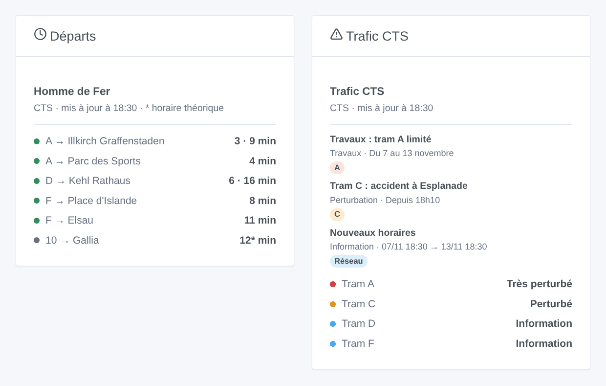

# CTS Strasbourg

## Présentation

Cette intégration amène dans Gladys les **trams et bus de Strasbourg** (CTS, Compagnie des Transports Strasbourgeois). Elle donne les **prochains passages en temps réel** aux arrêts que vous choisissez (trois dans le formulaire, jusqu’à 7 de plus avec un bouton), filtrés par ligne et direction, et le **trafic des lignes** que vous suivez : trafic normal, perturbé, très perturbé, avec les infos trafic de la CTS (perturbations, travaux, informations). Chaque arrêt et chaque ligne devient un appareil à afficher sur un tableau de bord et à utiliser dans les scènes.

Les données viennent de l’**API temps réel officielle de la CTS** (SIRI-lite), sous Licence Ouverte 2.0. Elle demande un **jeton personnel**, gratuit : la CTS ouvre l’accès à son portail open data sur demande. Les noms et codes des arrêts et des lignes viennent des horaires ouverts de la CTS (GTFS), lus une fois par semaine : chercher un arrêt ne consomme aucune requête.

Chaque arrêt suivi est une requête par lecture, toutes les minutes par défaut ; le trafic est lu toutes les 5 minutes. L’intégration garde chaque réponse aussi longtemps que l’API la dit valable, et se met en pause 5 minutes si l’API demande de ralentir. La nuit, tant qu’aucun arrêt n’annonce rien dans les 45 minutes, les arrêts sont lus toutes les 10 minutes.

Un passage est **suivi en temps réel** quand la CTS sait où est le véhicule ; sinon c’est l’**horaire théorique**, signalé « (théorique) » (une étoile dans le widget). L’API ne donne ni retard ni course supprimée : l’intégration n’en invente jamais.

C’est une intégration **cloud** : elle contacte `api.cts-strasbourg.eu` (avec votre jeton et les codes de vos arrêts) et `opendata.cts-strasbourg.eu` (les horaires ouverts). Rien d’autre ne quitte votre réseau.

L’intégration a été écrite d’après la description publiée de l’API (swagger.json) ; elle n’a pas encore été testée avec un vrai jeton. Vos retours sont les bienvenus.

## Prérequis

- Gladys Assistant 5.3.0 ou plus récent.
- Un jeton personnel de l’API de la CTS : demandez l’accès au portail open data par e-mail à `open-data@cts-strasbourg.fr`, avec quelques mots sur votre usage (par exemple « domotique Gladys Assistant »), puis copiez le jeton affiché dans votre compte open data.

## Configuration

| Champ              | Que saisir                                                                                                              |
| ------------------ | ----------------------------------------------------------------------------------------------------------------------- |
| Jeton              | Le jeton de votre compte open data de la CTS. Enregistré comme secret, jamais écrit dans les journaux.                  |
| Arrêt 1, 2, 3      | Le nom de l’arrêt (« Homme de Fer », « Gare Centrale ») ou son code : « 275 » pour tout l’arrêt, « 275A » pour un quai. |
| Ligne              | Seulement cette ligne : « A », « C1 », « 2 », ou un mode seul : « tram », « bus ». Vide : toutes les lignes.            |
| Direction          | Seulement les destinations qui contiennent ces mots : « Illkirch », « Illkirch \| Lixenbuhl ». Vide : les deux sens.    |
| Lignes suivies     | Les lignes dont vous suivez le trafic, séparées par des virgules : « A, C, 2, C1 » (jusqu’à 10). Un appareil par ligne. |
| Lecture des arrêts | Toutes les 30 secondes, toutes les minutes (par défaut), toutes les 2 minutes ou toutes les 5 minutes.                  |
| Langue des textes  | Noms des appareils, résumés et sorties des scènes, et langue des infos trafic (français, anglais, allemand).            |

Le bouton **Chercher un arrêt** donne les arrêts contenant quelques mots, avec leurs codes : « Homme de Fer [275] (275A, 275B, 275C, 275D) ». Le nombre désigne tout l’arrêt, dans tous les sens ; avec sa lettre, un seul quai. **Tester la connexion** lit les arrêts et lignes de la CTS, chaque arrêt suivi et le trafic tout de suite, et dit ce qui a répondu.

Plus d’arrêts que les trois du formulaire (maison, travail, école…) : **Ajouter un arrêt** prend les trois mêmes champs — arrêt, ligne, direction — et suit jusqu’à 7 arrêts de plus. **Lister les arrêts** montre tous les arrêts suivis, numérotés ; **Retirer un arrêt** prend ce numéro (ou le nom). Les arrêts ajoutés sont gardés dans la configuration de Gladys et suivent donc ses sauvegardes.

## Utilisation

### Appareils

Dans l’onglet **Découvrir**, créez les appareils voulus :

- **CTS \<arrêt\>** : le prochain passage en texte (« A → Illkirch Graffenstaden · 3 min »), l’attente du prochain passage et du suivant (minutes), et le nombre d’infos trafic en cours sur les lignes de l’arrêt (celles de tout le réseau comprises). La nuit, sans passage, les attentes gardent leur dernière valeur.
- **CTS tram A**, **CTS ligne 2** : le trafic de la ligne en texte (« Perturbé : Tram C : accident à Esplanade ») et son nombre d’infos trafic en cours.

### Trafic des lignes

L’état d’une ligne est son message en cours le plus grave : une **perturbation** la rend perturbée (très perturbée quand la CTS la marque urgente), une **perturbation prévue** perturbée, des **travaux** perturbée ou très perturbée quand ils dévient ou interrompent la ligne, une **information** laisse le trafic normal. Un message sur tout le réseau compte pour chaque ligne. Les textes de la CTS existent en français, anglais et allemand.

### Widgets du tableau de bord

- **Départs** : les prochains passages d’un arrêt, en compact. Une rangée par ligne et destination, avec ses prochains passages à la suite (« 3 · 9 min ») ; une étoile signale un horaire théorique. Le réglage **Trajets affichés** fixe le nombre de rangées. Choisissez un arrêt suivi, ou saisissez n’importe quel arrêt (et une ligne) dans les réglages du widget : un tel arrêt coûte une requête de plus à chaque rafraîchissement, toutes les minutes au plus. Avec **Plusieurs arrêts**, un seul widget montre plusieurs appareils arrêts.
- **Trafic CTS** : l’état des lignes suivies (ou des lignes saisies dans les réglages, ou les lignes de tram si aucune n’est suivie), puis leurs messages en cours et à venir. Touchez une carte pour le texte complet.

### Scènes

Déclencheurs, une fois par changement (la première lecture sert seulement de référence) :

- **CTS : départ bientôt** : un tram ou un bus à un arrêt suivi part dans 2, 3, 5, 10, 15 ou 20 minutes.
- **CTS : ligne perturbée** : une ligne suivie devient perturbée ou très perturbée.
- **CTS : fin de perturbation** : une ligne suivie qui était perturbée revient à la normale.
- **CTS : nouveau message trafic** : un nouveau message sur une ligne suivie, les lignes d’un arrêt suivi ou tout le réseau ; filtres par type (perturbation, perturbation prévue, travaux, information) et priorité. Une mise à jour se déclenche à nouveau quand la CTS demande de la notifier.

Chacun donne une phrase toute prête, `{{triggerEvent.data.summary}}`, et ses valeurs (ligne, destination, heure, titre, texte, période…). Les actions **CTS : prochains départs** et **CTS : trafic d’une ligne** renvoient le même genre de valeurs, à mettre dans un message ou à tester dans une condition.

Exemples :

- Quand le tram A vers Illkirch part d’Homme de Fer dans 5 minutes → allumer la lampe de l’entrée en vert.
- Quand le tram C devient perturbé → envoyer le résumé sur votre téléphone avant de partir.
- Chaque jour de semaine à 7 h 30 → lire les prochains passages de votre arrêt et les faire annoncer par l’enceinte de la cuisine.

### Transport

Cloud uniquement : les données viennent d’internet. Seuls les arrêts que vous suivez sont demandés à l’API, un par un, et le trafic du réseau toutes les 5 minutes.

## Dépannage

- **« Saisissez le jeton »** : le jeton manque ; demandez l’accès à `open-data@cts-strasbourg.fr` et collez le jeton de votre compte open data dans la configuration.
- **« L’API de la CTS refuse le jeton »** : vérifiez-le (pas d’espace avant ou après) ; l’intégration ne redemande rien tant que la configuration n’est pas enregistrée.
- **« L’API de la CTS demande de ralentir »** : l’API a répondu 429 ; les lectures reprennent après 5 minutes. Suivez moins d’arrêts ou choisissez un intervalle plus long.
- **« Inconnu ou ambigu »** : utilisez **Chercher un arrêt**, puis copiez le nom exact ou un code.
- **« (théorique) » après un passage** : la CTS ne suit pas ce véhicule en temps réel ; l’heure est celle des horaires.
- **Aucun passage** : la nuit, le réseau dort ; les arrêts sont lus toutes les 10 minutes.
- **Pour signaler un problème** : appuyez sur **Diagnostic**, puis copiez les lignes commençant par « CTS diagnostic » de l’onglet Journaux (le jeton n’y figure pas) dans une issue GitHub ou une réponse sur le forum, avec les versions de Gladys et de l’intégration.
